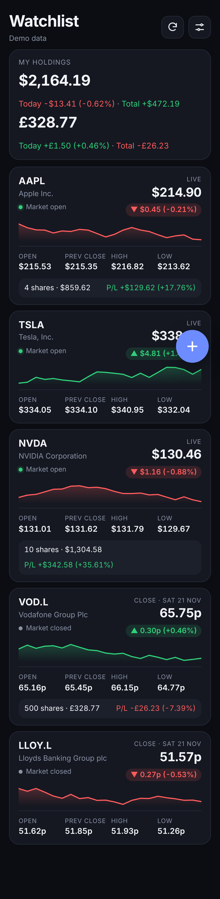

# Ticker Watch

A simple stock watchlist for your phone. Each stock shows:

- **Price**: live while the market is open, the **close** price once it shuts
- **Open**, **Prev close**, **High**, **Low**
- Market status: pre-market / open / after hours / closed
- A 1-month mini chart
- Optional: your shares + average price paid → value, today's change and P/L

It works for US stocks (`AAPL`, `TSLA`) and UK stocks (`VOD.L`, `LLOY.L`, which show in pence). Everything is saved in your browser and there's no login.

## Put it on your phone

1. On GitHub: **Settings → Pages**. Set Source to *Deploy from a branch*, pick this branch and `/ (root)`, then Save.
2. After a minute it's live at `https://<your-username>.github.io/Stock-Price-Tracker-/`.
3. Open that link in Safari, tap **Share → Add to Home Screen**. It opens full-screen like an app.

## Using it

- **+** adds a stock. Search by name or type the ticker.
- Tap a stock to see details, add your holding, reorder it or remove it.
- **Settings** lets you change the price source and how often it auto-refreshes.

## Price sources

- **Yahoo Finance** (default): no key needed, covers US and UK. Requests go through public relays because Yahoo blocks direct browser requests. Only the ticker is sent.
- **Finnhub**: get a free key at finnhub.io and paste it in Settings. It's more reliable, but the free plan is US stocks only.

Prices can be delayed up to 15 minutes depending on the exchange. Not financial advice.

Preview with sample data: add `?demo` to the URL.
